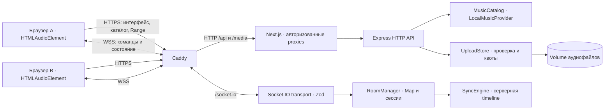

# Архитектура SYNC — «Слушаем вместе»

Протокол v4. Актуальные результаты проверок: [VERIFICATION.md](VERIFICATION.md). Основной режим — локальная музыка.
Backend, web и shared обновляются совместно; один backend-процесс хранит комнаты в Map.

В Docker-конфигурациях наружу выходит только Caddy. `/health` направляется в backend;
`/api/health`, остальные `/api/*` и `/media/*` проходят через Next.js. Это сохраняет авторизацию
media cookie: проксирование всех API напрямую в Express её обошло бы.
При запуске через npm используются отдельные порты 3000 и 4000.

## Границы модулей

| Модуль | Ответственность |
| --- | --- |
| `apps/web` | Next.js App Router, React, Tailwind, UI-компоненты, Zustand и настоящий HTMLAudioElement |
| `apps/server` | Express, Socket.IO transport, каталог, rooms, uploads и provider facade |
| `packages/shared` | Нейтральные TypeScript-контракты, Zod-схемы и чистый SyncEngine |
| `RoomManager` | Создание/членство/роли/сессии, revision, очередь и библиотека комнаты; не импортирует Socket.IO |
| `transport/room-events.ts` | Zod для каждой команды, ack, привязка socket к `music:<roomId>`, scoped broadcast |
| `MusicCatalog` | Файлы и метаданные общего локального каталога, allowlist, длительность |
| `UploadStore` | Потоковый временный файл, проверка содержимого, квоты, commit/cleanup; без Socket.IO |
| `ClockOffsetEstimator` | Серия timestamps, фильтрация RTT, оценка серверных часов |
| `PlaybackScheduler` | Общий deadline, отмена старых callbacks, применение timeline к MediaPort |
| `DriftCorrector` | Deadband, ограниченный playbackRate или seek по вычисленной ошибке позиции |

Web не импортирует server; shared не зависит от React/Express. Зависимости устанавливаются
из корня npm workspaces. Shared собирается первым. UI primitives находятся в
`apps/web/src/components/ui`, используют Radix Slot/shadcn-подобные варианты и доступные подписи.
У вкладки есть transport комнат и отдельное Socket.IO-подключение health-индикатора;
health socket не получает права участника комнаты.

## Серверное состояние и права

Room содержит `id`, `name`, `hostId`, `participants`, `library`, `queue`, `trackId`,
`trackRevision`, `playbackState`, `position`, `startedAt`, `revision`, `createdAt`.
Генерируемые ID: room 12 символов, participant 16; личный resumeToken 32 символа.
Каждый участник сообщает readiness текущей trackRevision, буфер, разрешение звука и clocks.

Создатель становится HOST. Только активный HOST меняет play/seek/трек и порядок очереди. Pause доступна любому
активному участнику. HOST может передать роль другому активному участнику и исключить
слушателя с отзывом его токена. Постоянный бан по публичной ссылке без аккаунтов не реализован.
Любой участник может загрузить запись, добавить в очередь и отправить реакцию; удалить запись
очереди может её автор или HOST. Сервер проверяет membership независимо от знания roomId.
Команда содержит точный expectedRevision. Проверка и изменение Map синхронны;
старая команда не переигрывается автоматически после смены состояния.
STALE_REVISION вызывает refresh snapshot и видимое предложение повторить действие.

Полный snapshot и player state имеют отдельные клиентские guards: поздний полный snapshot
может обновить participants, но не затереть более новую timeline. Track identity сохраняется
при изменении участников/очереди. Один HTMLAudioElement сохраняется и при смене файла:
подтверждённое разрешение живёт только в этой вкладке, readiness нового файла проверяется
автоматически. Reload или настоящий отказ autoplay требуют нового жеста.
Контракты: [API.md](API.md), [ROOM_PROTOCOL.md](ROOM_PROTOCOL.md).

## Аудио, uploads и приватность

Аудиобайты передаются по HTTP(S) с GET/HEAD/Range, никогда по Socket.IO.
В `media` принимаются безопасные обычные файлы WAV/MP3/OGG/M4A без symlink/подпапок.
Каталог читается при старте; теги/длительность разбираются music-metadata. Демо — оригинальные
PCM16 WAV из `scripts/generate-demo.mjs`; генератор не заменяет уже существующие файлы.

Uploads принимаются только от активного участника. Multer пишет поток на диск; file-type,
music-metadata и дополнительные WAV-проверки проверяют фактические байты, а не MIME/имя клиента.
Генерируется безопасное имя, публикация метаданных выполняется после повторной проверки доступа.
При отказе/отмене освобождаются резервы и удаляются временные/неопубликованные файлы.
По умолчанию: 20 MiB/файл, 100 MiB/комната, 512 MiB/сервер, 20 записей/комната,
четыре параллельные загрузки, длительность до четырёх часов. Proxy ограничивает тело запроса 21 MiB.

Next.js получает личный bearer только в запросах пользователя и после проверки сессии выдаёт
HttpOnly media cookie: SameSite=Strict, Path=/media, Secure на HTTPS. Cookie передаётся backend
как Authorization для приватного Range streaming. Токен не входит в URL, QR или broadcast.
API_INTERNAL_URL остаётся серверным. Caddy перезаписывает forwarded headers, фильтрует
Authorization/Cookie/Set-Cookie и query string в access log. Секреты/env/музыка исключены из Git.

## Синхронизация, reconnect и завершение

При ready всех активных слушателей HOST Play назначает серверный старт с запасом 750 мс.
Клиенты независимо калибруют clocks и воспроизводят один серверный anchor; умеренная ошибка
корректируется rate, большая — currentTime. Алгоритм и допущения: [SYNC_ALGORITHM.md](SYNC_ALGORITHM.md).
Сервер завершает композицию по каталожной длительности. При наличии очереди выбирается следующий
трек на паузе; для нового файла нужны новая готовность и новый Play.

После transport disconnect участник удаляется из публичного списка. HOST переходит первому
оставшемуся слушателю; возвращение не отбирает роль. Личная сессия удерживается 30 секунд
(RECONNECT_GRACE_MS), пустая комната — 5 минут. Токен живёт в sessionStorage конкретной вкладки.
Reconnect получает новый snapshot со всеми изменениями во время отключения, заново проверяет
буфер/clocks и media access. Permission одного audio сохраняется при смене файла и reconnect; reload или отказ autoplay
требуют пользовательского жеста. Локальный звук при обнаруженном disconnect приостанавливается.
Мёртвое соединение обнаруживается транспортом/heartbeat, а не обязательно мгновенно при потере сети.

## Docker и хранение

Три сервисa: production standalone web, Node server, Caddy. Web/server работают от node,
root filesystem read-only; запись разрешена в tmp/cache и upload volume. Restart unless-stopped,
healthchecks, init, resource limits и ротация JSON-log 10 MiB × 3 на сервис.
Внутренняя сеть не имеет прямого внешнего доступа; Caddy имеет сеть для входящих запросов/ACME.

Volumes сохраняют audio bytes и сертификаты, **не Map, сессии или библиотеку комнат**.
После рестарта backend прежние комнаты утрачиваются; файлы предыдущего процесса недоступны
как публичный каталог и очищаются после 24 часов. Для постоянной медиатеки сохраняйте исходники отдельно.
Healthcheck помечает unhealthy, но не перезапускает зависший процесс сам; restart policy действует при выходе.
Один backend нельзя масштабировать до нескольких replicas без изменения архитектуры.
Локальный HTTP и public HTTPS/локальный TLS-test разделены: [DEPLOY.md](../DEPLOY.md).

## MusicProvider и реальный статус «Звука»

Контракт: searchTracks/getTrack/getUserLibrary/getPlaylists/resolvePlayback.
LocalMusicProvider использует реальный каталог и приватную библиотеку комнаты; сохранённых
плейлистов нет, возвращается честная пустая коллекция. Внешний ProviderTrack не имеет local streamPath.

ZvukMusicProvider в production не подключён к музыкальному API. Все live operations возвращают
UNSUPPORTED; resolvePlayback дополнительно даёт каноническую официальную страницу валидного numeric ID.
Это не поиск по реальному каталогу и не синхронное воспроизведение «Звука». Сбер ID не подключён
и сам по себе не даёт музыкальные полномочия. Есть только тестируемый будущий metadata adapter
с серверным реестром разрешений; mock OK не доказывает live integration. DRM, extraction сессий,
проксирование подписного аудио и внешние музыкальные токены не используются.
Исследование/условия допуска: [ZVUK_INTEGRATION.md](ZVUK_INTEGRATION.md).

## Архитектурный референс и ограничения

Изучен [navidrome-jam](https://github.com/zhiganov/navidrome-jam) на commit
`9b18ce8b1f98e5844aae1a00e3966a409e589fa7`:
[RoomManager](https://github.com/zhiganov/navidrome-jam/blob/9b18ce8b1f98e5844aae1a00e3966a409e589fa7/server/src/roomManager.js),
[server](https://github.com/zhiganov/navidrome-jam/blob/9b18ce8b1f98e5844aae1a00e3966a409e589fa7/server/src/index.js),
[player](https://github.com/zhiganov/navidrome-jam/blob/9b18ce8b1f98e5844aae1a00e3966a409e589fa7/client/src/components/SyncedAudioPlayer.jsx).
Использован принцип разделения HTTP-медиа и серверного playback state. Код не копировался;
Navidrome, БД, Redis и сохранение комнат на диск не являются зависимостями SYNC.
Происхождение реализации: [ORIGIN.md](ORIGIN.md). Лицензии: [THIRD_PARTY_LICENSES.md](THIRD_PARTY_LICENSES.md).

Автотесты подтверждают согласованную timeline настоящих HTMLAudioElement в Chromium.
Физический выход на разных устройствах, Bluetooth, iOS/Safari и таймеры фоновых вкладок
не аттестованы. Нет регистрации, долговременного хранения комнат и полноценной защиты публичного
сервиса от DoS: есть quotas/лимиты rooms, sessions, uploads и reactions, но не глобальный rate limit.
Сборка/тесты и demo: [TESTING.md](TESTING.md), [DEMO.md](DEMO.md).
